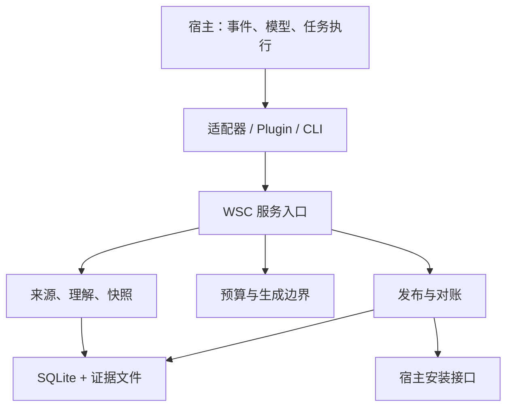

# WSC（Work State Compaction）

给长期运行的 coding agent 用的上下文压缩组件。独立进程内库，可以旁路接进宿主，默认关闭。

它想解决的问题不是"把上下文压得更小"，而是压缩之后 agent 还能不能把活干对：知不知道自己做到哪一步、哪些结论有依据、哪些还得重新确认，以及这些确认的代价是否值得。压缩率、状态字段数量、冷层调用次数都不算验收指标。

当前状态：可运行的 Python 包、检查点 CLI、宿主与模型接口、持久发布协议，加一套契约测试。没有并进任何主执行链，也不替换原生压缩。

## 背景

Agent 大致是 harness 加模型。harness 存着完整的运行记录，模型只能看到被塞进上下文的那一部分：

```
context = P(state, history, observation, goal, tools, policy, budget)
```

历史会一直长，所以 P 必须做选择。问题就出在这个选择上——系统里的记录是完整的，模型看到的东西却不再能表达当前这一步需要的信息和它们之间的关系。

举个具体的例子：

1. 文件 V1 跑过测试，通过。
2. 文件改成 V2，V2 还没验证。
3. 压缩之后剩一句"文件已修改，测试通过"。

这句话里每个字都是真的，但"测试通过"和"哪个版本"的对应关系没了。模型读到的结论是 V2 已验证，接下来它就会基于这个结论往下走。

记录没丢，丢的是区别。WSC 整个设计都是围着这句话转的。

## 做法

一次压缩在代码里是这样走的：

1. **记录来源。** 原生事件按原样入库，同一 id 重复投递不会产生新事件，一个批次在一个事务里提交。工具调用和结果靠 `(call_id, kind)` 唯一索引配对，缺一半的直接拒绝导出。opaque 项原样归档，不尝试解密，也不进热上下文。
2. **固定快照。** `Snapshot` 绑定 session、workspace、generation、control_epoch、understanding_epoch、cut 和来源摘要。cut 是来源序号，不是压缩后数组的下标。快照每次使用都重新校验，前缀变了就拒绝。
3. **记录理解。** 模型明确说出来的判断存成 `Understanding`，带来源、类别、适用范围和版本号。修订要带期望版本（CAS），并发改不会静默覆盖。系统允许存没有来源的假设，但不会把它升级成事实；`semantic_status` 一直是 `unverified`。
4. **选材交给模型。** 核心不做关键词排名，也不内置摘要提示词。三种前端（原文引用、字符区间、精确片段）都只负责把模型的选择绑到字节上：算范围、算哈希、校验唯一匹配。模型改写、来源对不上、路径已变，一律报事实状态，不修补。
5. **先算预算再谈生成。** 必留的 user/system/developer 消息和视图骨架有字节下界，超了就返回 `mandatory_view_byte_budget_exhausted`，这次生成连记账都不进。这里全程是字节，不是 token；真实容量由宿主按实际请求判断。
6. **导出候选，等宿主安装。** `stage` 只负责把包写到磁盘，状态是 `ready`。`install` 才进入安装，宿主在同一个同步边界里检查代次、控制版本、容量和在途工具，然后返回持久回执。只有 `confirmed` 才推进折叠游标。响应丢了走 `reconcile`，不重发；`lookup` 返回 `None` 表示结果未知，不表示没执行。
7. **证据留一条能走回去的路。** `read` 做授权检查和精确字节读取，部分哈希、对象哈希、观察时间、完整性分开报。引用可以带 `current_resource` 和它的哈希去查当前位置，只在唯一匹配时给行号。导出的是普通 TXT，内容寻址，热视图里带原文和存档入口。保存、发现、读取、使用是四件事，分开记。
8. **用量记成用量。** 生成调用在发出前记账，失败、超时、没回执都留着。没报的用量记 `null`，汇总里分成 `known_sum` 和 `unknown_attempts`。缺宿主用量和价格时不声称总费用已知。

几处刻意的保守选择：

- 当前机械保留全部原始 user/system/developer 消息。宁可热上下文大一点，也不自动宣布某条旧约束失效。约束选择优化还没做。
- 导出用同文件系统硬链接原子发布，不支持硬链接就失败，不退回覆盖写入。
- 停用需要真实移交回执，移交目录是普通 JSON/TXT，卸掉 WSC 也能读；停用不删来源。
- `off` 模式不建库、不调 factory、不改传进来的上下文对象。

架构上依赖是单向的：核心不引用适配器，适配器只依赖数据契约，模块之间没有循环导入，新模块不碰旧版的 memory / engine / server。



## 安装

Python 3.11 以上，运行时只用标准库。

```bash
python -m pip install --no-deps .
wsc --help
```

开发时不用装，把 `src` 放进 `PYTHONPATH` 就行。

```bash
PYTHONPATH=src python -m wsc --help
```

跑测试：

```bash
python -m unittest discover -s tests -v
```

## 用法

```python
from wsc import WSC, Store, Selection, Understanding
from wsc.adapters.codex import CodexCheckpointAdapter
from wsc.adapters.callback import CallbackHost

core = WSC(
    Store(db_path, session_id=session_id, workspace=workspace),
    access=current_source_permission,   # 宿主提供的当前授权检查
)

adapter = CodexCheckpointAdapter()
core.ingest(adapter.import_items(native_items, thread_id=native_thread_id))
core.presented(request_id, actually_presented_source_ids, receiver=actual_receiver)

snapshot = core.capture(cut=source_boundary)
view = core.prepare(
    snapshot,
    Selection(new_understandings=(Understanding(
        text=explicit_model_statement,
        kind="diagnosis",
        sources=statement_source_ids,
        scope=known_scope,
    ),)),
    producer=model_output_identity,
)

operation = core.stage(view, directory=export_directory, adapter=adapter)
host = CallbackHost(commit=atomic_host_install, lookup=durable_host_lookup)
receipt = core.install(operation, host)
```

需要模型产出选材时用 `core.generate(snapshot, generator, producer=..., limits=...)`。generator 收到公开材料，返回 `Generated(Selection(...), Usage(...))`。组件本身不带供应商、不带提示词、不读密钥；实际调用和诚实用量由调用方负责。`JsonCommandGenerator(argv)` 提供了一个 stdin/stdout 的 JSON 传输，不经 shell。

CLI 的每条命令都显式绑定 `--db`、`--session`、`--workspace`，不会去猜或改现有会话：

```bash
wsc --db state.db --session sample --workspace . import-native --input canonical-state.json
wsc --db state.db --session sample --workspace . presented --receipt presentation.json
wsc --db state.db --session sample --workspace . material
wsc --db state.db --session sample --workspace . prepare --selection selection.json --producer existing-model-output
wsc --db state.db --session sample --workspace . export --view VIEW_ID --directory checkpoint-output
wsc --db state.db --session sample --workspace . status
```

`presentation.json` 是 `request_id`、`source_ids`、`receiver`。没有真实呈现证据就不能填生产接收方，离线回放要明确标成回放接收方。

## 目前做到哪

测试 430 条，覆盖来源、绑定、预算、发布、对账、证据和实验准入。

有真实记录支撑的：

| 事项 | 结果 |
| --- | --- |
| 原生事件回放 | 46 条事件往返一致，含 9 对工具调用/结果、16 条 opaque，原始角色和顺序保留，新增模型调用 0 |
| B/C 具名检查 | 两臂各 18 项通过，最终产物相同；C 非缓存输入少 49% |
| 跨压缩工具访问 | 同一 session 的持久 PowerShell 会话在自动压缩后仍可访问，PID、nonce、心跳一致 |
| C 双次压缩交付 | 原 S2、原 S3 请求在同一会话内自动压缩两次后正常完成，通过 17 项独立验收；4197357 tokens，60 普通响应加 2 压缩响应 |
| 发布协议 | 超时、响应丢失、终局拒绝、恢复对账都有状态和测试；`ready` 不推进游标 |

没有证明的，别当成结论：

- 总体经济性。只验证过局部上下文体积下降，每个成功任务的总成本没测。
- WSC 的语义摘要比原生好。C 臂的摘要由原生内部压缩生成，不能记在 WSC 头上。
- 通用缺口识别。现在没有任何机制能自动判断模型缺了什么信息。这是研究目标，不是已实现功能。
- 长期稳定性。五个应用任务各三轮没跑完，多轮之后的错误复活和状态漂移没有量化。
- 调度收益和 WSC 增量。缺同阈值的原生诊断对照，分不清"压缩更早"和"WSC 管理得更好"。
- 重复性。上面 C 的结果都是单次观察，不是统计效应。

## 已知限制

- Codex 适配器只做显式检查点导出和恢复，没有透明原位替换。来源文件正确不代表宿主真的用了新上下文。
- 宿主如果没有原子安装和持久查询能力，就只能停在导出边界。可见导入不算安装证明。
- 全来源核对加独立导出目录，工作量跟历史规模相关；大规模多轮压缩的存储和延迟优势没验证。
- 字节上限不等于 token 预算。JSON 命令传输有超时和输出大小检查，但不是子进程沙箱。
- 导出授权和后续文件访问是两个边界，撤销回调权限不会撤回已经导出的副本。
- 多租户必须走 SDK 的授权回调，CLI 用的是本地文件权限。
- 跨目录复用原生压缩状态不可靠，2026-10-23 的跨目录候选在正式 C 臂失败，没设成默认。

## 目录

```
src/wsc/          组件源码，约 2.3k 行
  contracts.py    数据契约与端口
  core.py         服务入口
  events.py       来源身份、配对、呈现回执
  snapshots.py    快照校验
  understanding*.py  带来源的理解与 CAS 修订
  excerpts.py / references.py / evidence.py  精确片段、版本匹配、授权读取
  quote_selection.py / span_selection.py     选材前端
  view_budget.py  字节下界与准入
  publication.py  发布、对账、折叠、移交
  store.py / accounting.py  单会话 SQLite 与尝试账本
  adapters/       codex、covered、factual、recorded、native_carrier、callback
tests/            430 条契约测试
experiments/      旁路实验驱动与结果
reviews/          每轮决策、反例和止损记录
validation/       逐轮验证证据
benchmarks/       任务集与评分口径
```

`reviews/` 是这个仓库的决策日志。每轮都写了为什么改、证据是什么、哪里失败、为什么停。看代码之前先翻它，比猜快。

## License

MIT，见 [LICENSE](LICENSE)。
