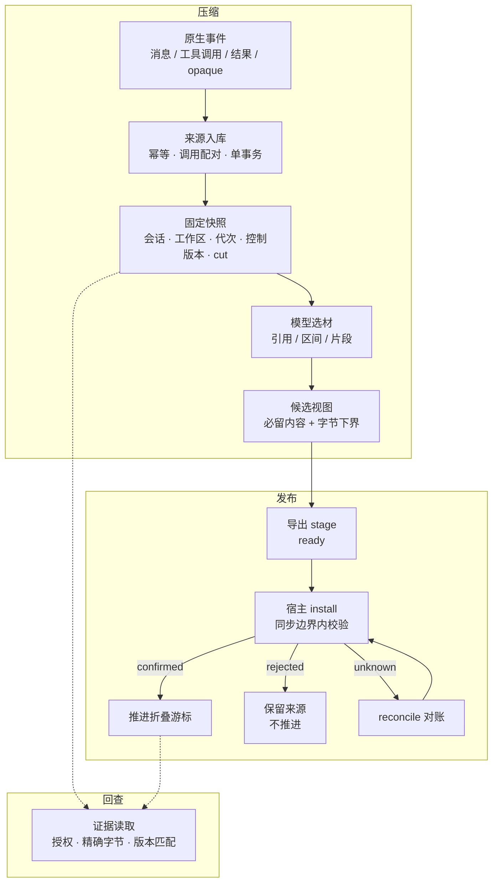

# WSC

Work State Compaction。给长期运行的 coding agent 做上下文压缩的 Python 组件。独立进程内库，旁路接入，默认关闭。

压缩最容易出的问题不是丢信息，而是"看起来接上了，实际接错了"。文件 V1 通过测试，改成 V2 后还没验证，压缩完只剩一句"文件已修改，测试通过"——字都是真的，版本对应关系没了，模型据此认为 V2 已验证。WSC 把压缩当成一次可核对的发布，而不是一次改写文本。

## 机制

### 简单描述

取一段不可变的来源，固定成快照，让调用方的模型决定留什么，在字节预算内生成候选视图，交给宿主原子安装，拿到持久回执之后才推进折叠位置。任何一步结果不确定，就停在原地，不猜、不重发。

### 完整描述

**1. 来源。** 原生事件（消息、工具调用、工具结果、opaque 项）按原样入库。同一 id 重复投递不产生新事件，一个批次在一个事务里提交。工具调用和结果靠 `(call_id, kind)` 唯一索引配对，缺一半直接拒绝导出，不完整的东西不许进入压缩。opaque 项原样归档，不尝试解密，也不进热上下文。

**2. 快照。** 一次压缩的输入固定成快照，绑定会话、工作区、代次、控制版本、理解版本、`cut` 和来源摘要。`cut` 是来源序号，不是压缩后数组的下标。快照每次使用前重新校验，前缀变了就拒绝。控制或理解版本变化会让旧候选失效；新到的普通尾部事件不会。

**3. 选材。** 留什么由调用方的模型决定，核心不做关键词排名，也不内置摘要提示词。三种前端（原文引用、字符区间、精确片段）只负责把选择绑到字节上：算范围、算内容哈希、校验唯一匹配。模型改写、来源对不上、路径已经变了，一律返回事实状态，不修补。必留的 user/system/developer 消息强制并入，不受选材影响。模型明确说出的判断另存为理解，带来源、类别、适用范围和版本号，修订走 CAS，没有来源的假设不会被升级成事实。

**4. 预算。** 生成前先算必留消息与视图骨架的字节下界。下界已超 `max_view_bytes` 时，在模型调用和记账之前返回 `mandatory_view_byte_budget_exhausted`；候选整体超限同样拒绝。上限按字节计，不按 token 折算，真实容量由宿主按实际请求判断。

**5. 发布。** 候选写盘只是 `ready`，不等于安装。`install` 时宿主在同一个同步边界内检查代次、控制版本、容量和在途工具，返回持久回执；只有 `confirmed` 才推进折叠游标。`rejected` 表示该操作从未安装且此后不会安装，可以安全重做；`lookup` 返回 `None` 表示结果未知，不等于没执行，此时走 `reconcile` 对账，不重发请求，也不重复执行任务工具。安装超时保留来源和未推进的游标。

**6. 证据与账本。** 证据读取单独一层：授权检查加精确字节读取，部分哈希、对象哈希、观察时间、完整性分开报；引用可以带资源哈希去查当前位置，只在唯一匹配时给行号。用量单独记账：调用发出前登记，失败、超时、没回执都保留，没报的用量记 `null`，汇总分成已知和未知两类。

组件不判断语义对错，不调用模型，不替宿主执行任务，不伪造安装回执。宿主如果没有原子安装和持久查询能力，就只能停在导出边界。

### 机制图



## 安装

Python 3.11 以上，运行时只用标准库。

```bash
python -m pip install --no-deps .
```

## 用法

```python
from wsc import WSC, Store, Selection, Understanding
from wsc.adapters.codex import CodexCheckpointAdapter
from wsc.adapters.callback import CallbackHost

core = WSC(
    Store(db_path, session_id=session_id, workspace=workspace),
    access=current_source_permission,      # 宿主提供的授权检查
)

adapter = CodexCheckpointAdapter()
core.ingest(adapter.import_items(native_items, thread_id=native_thread_id))
core.presented(request_id, presented_source_ids, receiver=actual_receiver)

snapshot = core.capture(cut=source_boundary)
view = core.prepare(snapshot, Selection(), producer=model_output_identity)

operation = core.stage(view, directory=export_directory, adapter=adapter)
host = CallbackHost(commit=atomic_host_install, lookup=durable_host_lookup)
receipt = core.install(operation, host)
```

选材也可以交给模型：`core.generate(snapshot, generator, producer=..., limits=...)`。generator 收到公开材料，返回 `Generated(Selection(...), Usage(...))`。组件不带供应商、不带提示词、不读密钥。

CLI 每条命令都显式绑定 `--db`、`--session`、`--workspace`，不会去猜或改现有会话：

```bash
wsc --db state.db --session sample --workspace . import-native --input canonical-state.json
wsc --db state.db --session sample --workspace . prepare --selection selection.json --producer existing-model-output
wsc --db state.db --session sample --workspace . export --view VIEW_ID --directory checkpoint-output
wsc --db state.db --session sample --workspace . status
```

## 状态

仍在逐步实验中，暂不建议直接接生产链路。

## License

MIT
