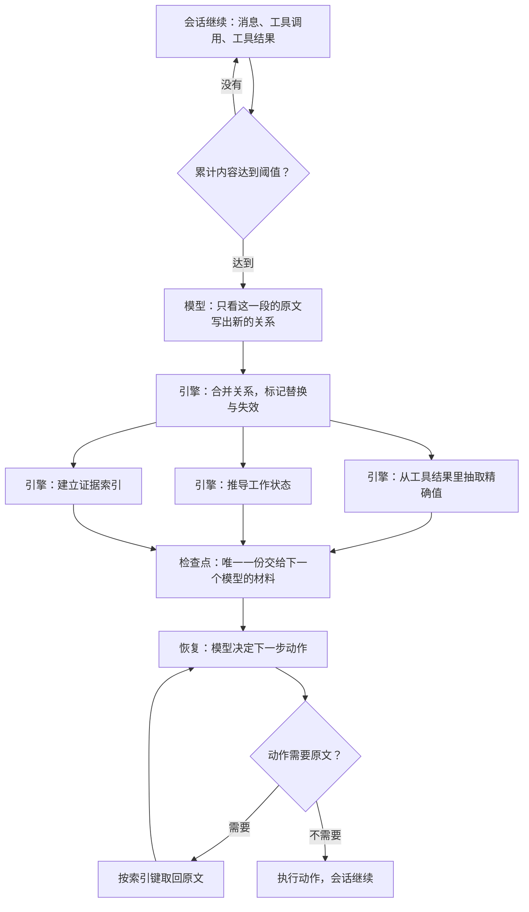
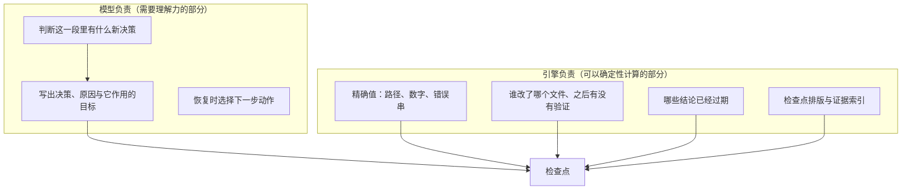
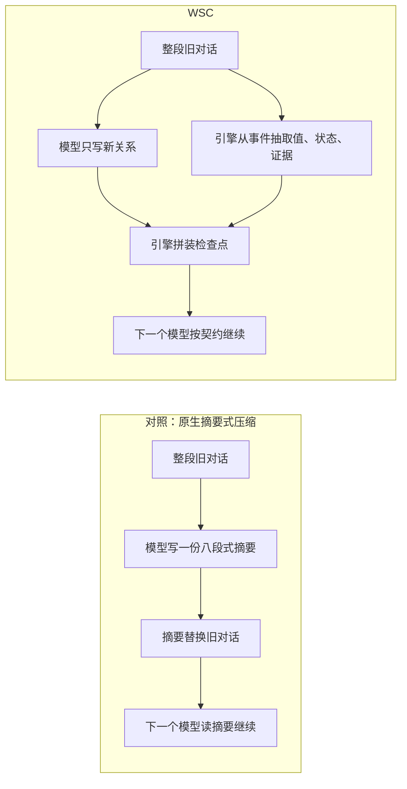

# WSC 设计说明：给第一次接触的人

> 本文不假设你读过代码，也不假设你知道 WSC 是什么。所有术语第一次出现时用括号解释。
> 说明对象：WSC 当前默认版本（内部代号 `wsc_nosig`，即“阈值触发、不带额外提示”的版本）。

---

## 一页看懂

- **WSC 是什么**：一套让 AI 编程助手在超长会话里“不忘记关键事情”的压缩方法（英文 Work State Compaction，工作状态压缩）。
- **它解决什么问题**：会话太长会超出模型的上下文窗口（模型一次能记住的最大文本量），必须把早期内容压成一段“检查点”（压缩后交给下一个模型的唯一材料）。普通做法让模型写摘要，摘要会丢精确值、改错文件名、把已过时的决定继续沿用。
- **它怎么做**：模型只负责“理解”——说出这一轮出现了什么新的决策和原因；其余全部交给引擎（不调用模型、结果完全确定的程序）来拼装：精确值、工作状态、文件改动与验证、证据目录。
- **代价**：检查点变得很小、很确定，但模型在压缩和恢复时仍要花推理（模型在给答案前的内部思考），这部分成本目前高于普通摘要，尤其在内部思考很长的模型上。

---

## 二、先用一个小故事说明问题

设想一个编程会话：

1. 用户要求：把重试逻辑改成使用幂等键（idempotency key，一种防止同一请求被重复执行的标识）。
2. 模型排查后发现：重试代码绕过了客户端，决定使用 `send_once`（只发送一次的函数），不要使用 `send_batch`（批量发送的函数）。
3. 会话继续了 20 轮，期间还跑了很多无关的检查。

上下文快满了，需要压缩。如果让模型写一段摘要，常见的事故是：

- 摘要写成“使用客户端发送”，丢掉了 `send_once` 这个精确名字；
- 下一个模型看到“客户端”就去改了 `src/client.py`，而真正该改的是 `src/retry.py`；
- 或者摘要里还留着已经被推翻的旧方案。

WSC 的目标就是让这类信息**不靠模型复述，而由程序确定性地保留**。

---

## 三、关键术语（括号里是意思）

| 术语 | 意思 |
| --- | --- |
| 上下文窗口（context window） | 模型一次能“看到”的最大文本量，超出就必须丢弃或压缩 |
| 压缩（compaction） | 把早期对话换成一小段材料，腾出空间 |
| 检查点（checkpoint） | 压缩后交给下一个模型的唯一材料 |
| 事件（event） | 会话里的最小事实单位：一条消息、一次工具调用、一次工具结果 |
| 引擎（engine） | 不调用模型、只做确定性计算的程序；同样的输入永远得到同样的输出 |
| 关系（relation） | 必须长期保留的一句话判断，例如“决策：使用 send_once，因为 send_batch 只适合批量任务” |
| 账本（ledger） | 关系的清单，带“当前有效 / 已替换 / 已失效”等状态 |
| 精确值（exact value） | 不能改写的字面内容：文件路径、数字、函数名、错误串 |
| 状态（work state） | 工作做到哪：已完成、未完成、下一步、还缺什么 |
| 检查收据（receipt） | “某次编辑之后，某次检查覆盖了它”的机械记录 |
| 证据索引（evidence index） | 一份目录，用短键（如 `E3`）指向原始证据，按需取回 |
| 取回（fetch） | 用索引键把原文换回来的动作 |
| 恢复（resume） | 压缩之后，下一个模型接着干活 |
| 契约（contract） | 给模型的行为规则，规定它能输出什么、必须遵守什么 |
| 阈值（threshold） | 触发压缩的门槛，例如累计内容超过约 8k token |
| token（计费单位） | 模型处理文本的最小单位，费用按 token 计 |
| 推理 token（reasoning tokens） | 模型在给出最终答案前“心里想”的内容，也计费 |
| 采样（sample） | 同一个用例独立跑一次；单次结果只是一次采样 |
| 标准差（standard deviation） | 衡量多次结果波动大小的数 |
| oracle（标准答案） | 由人固定的正确下一步动作，用来机械判定对错 |
| 归因（attribution） | 判断失败是模型没照做，还是机制没给到信息 |

---

## 四、总体流程

一句话概括：**模型只做理解，引擎做拼装；检查点不是模型的作文，而是引擎的报表。**

---

## 五、模型和引擎各负责什么

这样分工的原因很直接：

- 引擎能算的，让模型算就是浪费 token，而且会算错、会改写法；
- 模型能做的（判断“这是不是一个新决策”），引擎做不了，所以只保留这一小块给模型。

---

## 六、五个部件，逐个说明

### 6.1 触发：什么时候压缩

**做什么**：不是每一轮都压缩。未达到阈值时只累积（把新内容先存着）；只有累计内容超过阈值（本版本约 32000 字符，约 8k token）或会话结束时，才调用一次模型。

**为什么**：早期版本每轮都压缩，20 轮就会调用 20 次模型，而大多数轮次没有新决策。压缩调用数与轮次成正比，是成本失控的主因。

**短会话怎么办**：如果用例本身没有设置阈值，就用确定性门控（gate，决定要不要调用模型的条件）：只有出现用户指令，或者出现失败、被记录下来的决策时，才压缩；同一个信号触发的压缩至少间隔 2 轮，避免重复付钱。

**收益怎么确认**：20 轮用例从 20 次压缩降到 2 次；两个模型各 5 次采样，质量全部通过。

### 6.2 关系账本：模型只写“引擎推不出来的东西”

**做什么**：模型收到一段带编号的对话区域，只输出新关系（以及必要的修订），每条一句话、带原文编号作为引用，最多 5 条关系、3 条修订。

**写什么**：
- 决策及其原因，例如“决策：重试改用 send_once，因为 send_batch 只用于批量任务”；
- 目标路径和所选标识符，例如“作用于 src/retry.py”；
- 引擎看不到的修正。

**坚决不写什么**：
- 不抄工具结果里的精确值（引擎会抄）；
- 不复述用户原话（引擎会逐字引用）；
- 不描述“我执行了某个命令”（引擎能从事件里看到）；
- 不写“测试通过”这种没有绑定版本的结论。

**为什么**：早期契约让模型同时做抽取、判断、改账本、写状态，推理量大约是纯抽取的两倍，还容易把引擎能算的缺口也写一遍。把模型限制成“只抽取”，成本和质量都更稳。

**收益怎么确认**：单次压缩的推理量明显下降（DeepSeek 约 2.1k，对照的原生摘要约 0.37k），同时两模型两用例各 5 次采样全部通过。

### 6.3 精确值账本：能从工具结果拿到的，绝不让模型背

**做什么**：引擎扫描所有工具事件，把不能改写的精确值抽出来，编成稳定的编号（`V1`、`V2`……），每条带来源标签和检索词。错误、测试结果、填充文本、重复值会被跳过。

**为什么**：值本来就在工具结果里，让模型抄写只会带来两种事故：抄错（数字、路径、错误串被改写），或者“提到了但没取到”（模型凭印象写值）。由引擎生成，值不会变，也不需要花模型 token。

**预算不够怎么办**：值可以按编号取回；即使值段被裁掉，编号依然有效，模型可以按键取回原文。

**边界（很重要）**：引擎只从工具结果里取值。助手自己的决策里出现的标识符（比如 `send_once`）不是工具结果，引擎拿不到，必须由模型写进关系。曾经试过“所有精确值都交给引擎”，结果模型把目标路径也省略了，5 次里 4 次改错文件，这个方向已被否决。

### 6.4 工作状态与检查收据：谁做到哪、有没有验证

**做什么**：引擎从账本和事件里推导四类状态：
- `done`（已完成且验证过）；
- `open`（未完成）；
- `next`（记录下来的下一步）；
- `unknown`（证据不足，例如“编辑之后没有检查覆盖”）。

同时记录收据：某次编辑之后，哪次检查覆盖了它；如果同一个文件后来又改了，旧检查自动标记为“不再覆盖”。

**为什么**：状态如果让模型写，会出现同一件事写两遍、需求原文被复制多份、编辑失败了也被当成成功。改成引擎推导后，每个事实只出现一次，失败和过期都能被机械识别。

### 6.5 检查点与证据索引：一份材料 + 一个目录

**做什么**：引擎把控制段（用户要求，逐字引用）、关系账本、工作状态、检查收据、精确值、证据索引拼成一份自然语言说明。空间不够时按固定顺序裁剪：先裁导航索引，再裁最旧的值，最后裁价值最低的关系。

**为什么**：模型恢复时需要的不是“全部原文”，而是“当前结论 + 一个能按需取原文的目录”。这样检查点可以很小（本版本约 1.6–1.9KB），需要细节时再取。

**证据怎么找**：索引给每条证据一个短键和几个检索词；模型需要原文时按键取回，引擎把原文交给它。

### 6.6 恢复契约：接下来怎么干

**做什么**：恢复阶段给模型一套动作规则，最多 3 回合：
- 第一回合就给出最终动作，如果状态已经覆盖了任务，不允许再取回或读文件；
- 需要多个键时，一次性列全，避免来回多回合；
- 检查点里出现了精确值段时，才告诉模型“这段是权威的，不要为取值去读文件”；
- 最后回合禁止取回，强制收敛到动作。

**为什么**：恢复的成本主要来自回合数和模型推理。早期版本会出现“先取回一次、再回答一次”的额外回合；而检查点没有值段时仍讲值规则，属于无效指令，只会让模型多想。把契约按检查点内容组合后，同样的检查点、同样的质量，恢复成本下降约 25%。

---

## 七、设计原则（用人话）

1. **能算的不要问。** 引擎能确定的东西（值、状态、谁改了文件），不交给模型。
2. **只让模型做判断。** 模型负责“这是什么决策、为什么”，不负责排版和抄写。
3. **压缩和恢复分开算账。** 压缩省钱不代表恢复省钱，两个阶段分别测量。
4. **异常要成为状态。** 失败、过期、没验证，都要能被下一步看到，而不是消失。
5. **只在需要时付钱。** 达到阈值才压缩，短会话不触发。
6. **改动必须有证据。** 每个机制都要有离线检查、重复采样和失败归因，才能进默认版本。

---

## 八、怎么判断“真的变好了”

这是这套设计里最容易被忽视、但最重要的一部分。

### 8.1 单次运行会骗人

同一个用例换一次运行，成本就可能翻倍。实测中，对照方案在某个短用例上的 5 次成本从约 0.07 元到约 0.25 元不等，波动比两个方案的平均差距还大。**只看一次运行，结论可能是噪声。**

### 8.2 判定方法

- **每个组合跑 5 次独立采样**（每次使用独立缓存——缓存是指把模型回答暂时存起来、相同请求直接复用；这里必须禁用，否则 5 次会变成同一个答案）；
- **质量用机械标准答案**（oracle）：预先固定“必须做哪个动作、禁止做哪个动作”，模型输出后逐条比对，不靠模型自评；
- **成本报均值 ± 标准差和区间**，并说明两个方案的区间是否重叠；
- **失败必须归因**：是模型没照做（模型侧），还是机制没把信息给到（机制侧）。信息齐全而模型没照做，不加机制去“哄”模型。

### 8.3 这套方法带来的结论

- 质量：WSC 在两个模型、两个用例、各 5 次采样里 20/20 通过；对照方案 19/20，唯一失败是模型侧——检查点已经写明了正确函数，该样本仍然用了旧调用。
- 成本：WSC 的均值高于对照方案，长用例约 1.45–1.9 倍；但深挖后发现差距几乎全部来自模型推理，而不是检查点大小。

---

## 九、和 DSH 原生压缩的对比

DSH（本次对照的官方编程助手运行时）自带的压缩方式是：让模型把旧对话写成一份固定八段的摘要，再用摘要替换旧内容，保留尾部少量原文。

### 结构对比

| 维度 | DSH 原生 | WSC |
| --- | --- | --- |
| 模型输出 | 固定八段摘要（含“下一步”） | 最多 5 条关系 + 3 条修订 |
| 精确值 | 靠模型抄写 | 引擎从工具事件生成编号 |
| 工作状态 | 摘要里的文字 | 引擎推导：完成 / 未完成 / 下一步 / 缺证据 |
| 检查覆盖 | 摘要里描述 | 机械收据：编辑 → 后续检查，过期可判定 |
| 证据 | 摘要本身 | 原文存档 + 短索引，可按键取回 |
| 检查点大小 | 约 6KB | 约 1.6–1.9KB |

### 质量对比（两模型 × 两用例 × 各 5 次）

| 模型 | 用例 | DSH 原生 | WSC |
| --- | --- | --- | --- |
| DeepSeek（深度求索公司的模型） | 短会话 | 4/5 | 5/5 |
| DeepSeek | 20 轮长会话 | 5/5 | 5/5 |
| GLM（智谱公司的模型） | 短会话 | 5/5 | 5/5 |
| GLM | 20 轮长会话 | 5/5 | 5/5 |
| 合计 | | 19/20 | 20/20 |

### 成本对比（人民币，5 次均值 ± 标准差）

| 模型 | 用例 | DSH 原生 | WSC | 关系 |
| --- | --- | --- | --- | --- |
| DeepSeek | 短会话 | 0.0429 ± 0.0082 | 0.0725 ± 0.0074 | 约 1.7 倍 |
| DeepSeek | 20 轮长会话 | 0.0281 ± 0.0060 | 0.0407 ± 0.0080 | 约 1.45 倍，区间有重叠 |
| GLM | 短会话 | 0.1384 ± 0.0616 | 0.2105 ± 0.0434 | 约 1.5 倍，区间有重叠 |
| GLM | 20 轮长会话 | 0.0727 ± 0.0135 | 0.1404 ± 0.0451 | 约 1.9 倍 |

> 说明：短会话在真实产品里几乎不会触发压缩；表中的短用例是评测框架人为制造的压缩场景，只作方向参考。真正有意义的是 20 轮长会话。

### 钱到底花在哪

| 阶段 | DeepSeek 原生 | DeepSeek WSC | GLM 原生 | GLM WSC |
| --- | --- | --- | --- | --- |
| 压缩 | 0.0137 | 0.0202 | 0.0246 | 0.0621（含重试） |
| 恢复：最终回合 | 0.0094 | 0.0176 | 0.0355 | 0.0380 |
| 恢复：中间回合 | 0.0050 | 0.0029 | 0.0127 | 0.0357 |
| 合计 | 0.0281 | 0.0407 | 0.0727 | 0.1404 |

- 精确值管理本身不花模型 token；
- 检查点小很多，但输入 token 只占总成本 6–8%；
- 主要差距是模型在压缩和恢复时的内部推理：GLM 一次压缩可达约 7k 推理 token，对照方案约 1.9k；
- 对照方案的摘要自带“下一步”，模型恢复时想得少；WSC 的状态更短，模型要自己补出下一步。这是当前版本“用推理换确定性”的代价。

---

## 十、被否决的想法（负结果同样重要）

| 想法 | 尝试结果 | 为什么不用 |
| --- | --- | --- |
| 压缩时额外提示“别忘了失败和决策” | 质量没有提升，成本上升 | 模型本来就看得到原文，提示只是让它多想 |
| 每一轮都压缩 | 20 轮用例要调用 20 次 | 大多数轮次没有新决策，成本与轮次成正比 |
| 精确值全部交给引擎，模型一条都不写 | 模型把目标路径也省了，5 次里 4 次改错文件 | 助手决策里的标识符不是工具结果，引擎拿不到 |
| 把引擎已有的值从账本里隐去 | 呈现更小，但没有稳定的质量收益 | 不进入默认版本 |
| 降低模型输出上限来省钱 | 推理先被截断，输出变成空 | 省不了推理，反而丢结果 |
| 用提示词强迫模型少想 | 属于给模型行为打补丁 | 信息齐全而模型多想，归模型侧，不为此加机制 |
| 只看一次运行就下结论 | 结论会随采样翻转 | 已被“5 次独立采样”取代 |

---

## 十一、当前版本的边界与未解问题

- **成本还没全面过线**：GLM 长用例约为对照方案的 1.9 倍，DeepSeek 长用例只在分布层面接近。
- **验证场景仍偏合成**：目前用的是构造的 20 轮会话；真实仓库的长会话与人工标准答案还没采集。
- **多键取回未专项压测**：规则要求一次列全所需键，但还没有专门构造“必须同时取回多个键”的压力用例。
- **生产路径未接入**：这些能力目前存在于评测框架里，还没有接进实际编程助手运行时。
- **格式失败仍有成本**：GLM 约 3–6% 的调用会返回无法解析的 JSON（一种结构化文本格式），需要重试；宽松修复尚未实施。
- **短会话成本不具代表性**：评测框架在短用例上人为触发了压缩，真实产品不会这样。

---

## 十二、一句话总结

WSC 的核心不是“让模型写更好的摘要”，而是**把不该由模型记的东西从模型手里拿走**：精确值、工作状态、检查覆盖、证据目录都由引擎确定性生成；模型只回答“这一轮有什么新决策、为什么”。

它已经让长期会话的质量在重复采样中稳定优于普通摘要，代价是更高的模型推理成本；下一步要解决的不是压缩率，而是把成本压到与对照方案同一水平，同时在真实长会话上复现。
