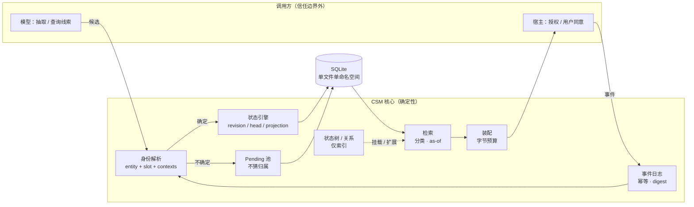

# Architecture Description: CSM（Context State Machine）V1

## 0. Clarifications & Assumptions

| 输入 | 本文件采用的内容 |
| --- | --- |
| 问题陈述 | 长期对话/Agent 任务需要可追溯的记忆身份、状态版本和“当时成立”的检索；相似度召回无法区分历史与当前，也无法阻止错误合并 |
| 当前状态 | `src/wsc/csm/` 已实现模块化单体 V1：SQLite 单文件命名空间、事件日志、身份路由、追加式版本、投影、待绑定、关系、状态树、检索与装配；接口仍在演进 |
| 功能需求 | 事件入库、候选记忆校验、身份绑定/延迟绑定、状态转移校验、版本与投影、关系与依赖、渐进式树、按时间点检索、证据召回、上下文装配、CLI |
| 非功能需求 | 单机可运行、默认无网络/无隐式模型调用、失败返回机器可读原因而非猜测、追加历史不可覆写、结果可重建、按字节限预算 |
| 约束与风险 | 语义判断由调用方模型提供；核心不做关键词排名或摘要；SQLite 单写者；多租户、删除治理、权限体系未内置 |
| 预期读者与用途 | 设计评审 / RFC / 交接；读者需能判断边界、取舍与失败模式 |

**方向性未知项：无。** 以下缺失项只影响容量与部署细节，按显式假设继续。

| 编号 | 假设 | 可证伪方式 |
| --- | --- | --- |
| A1 | 单租户个人记忆；一个 SQLite 文件对应一个命名空间 | 若需跨用户共享一个库，则隔离模型不成立 |
| A2 | 调用方负责语义抽取、模型调用与用户授权 | 若要求核心内置模型/密钥，则信任边界需重画 |
| A3 | 容量按第 3 节三档估算 | 实测事件量/身份数超出高档，需改用索引或分片 |
| A4 | 部署为单进程写入、少量并发读取 | 若多进程高频写，`BEGIN IMMEDIATE` 串行化会成为瓶颈 |
| A5 | 默认词汇检索；向量/混合模式是可选旁路 | `WSC_CSM_RECALL` 默认值为 `lexical`（[recall_policy.py:8](../src/wsc/csm/recall_policy.py#L8)） |
| A6 | 本文只描述机制，不把评测分数当作机制正确性的证明 | 评测配置、样本与版本需单独报告 |

**事实与假设的区分：** 带文件行号的陈述为源码事实；“估算/假设/需实测”字样为假设。

---

## 1. Goals & Non-Goals

**Goals**

1. 原始事件按 id 幂等入库；同一 id 内容变化直接拒绝（[service.py:46](../src/wsc/csm/service.py#L46)）。
2. 每条记忆有稳定身份：`entity + slot + 已声明 contexts`，相似度不参与身份判定（[contracts.py:129](../src/wsc/csm/contracts.py#L129)）。
3. 状态以追加版本表达；当前指针、版本、投影在同一事务提交（[state.py:109](../src/wsc/csm/state.py#L109)）。
4. 归属不确定时进入 pending，而不是猜一个最像的身份（[identity.py:43](../src/wsc/csm/identity.py#L43)）。
5. 检索结果带分类与证据：当前、历史、待绑定、未知不得混读（[retrieval.py:316](../src/wsc/csm/retrieval.py#L316)）。
6. 状态树只做索引，不改事实；结构操作可预演、可拒绝、可审计（[tree.py:1](../src/wsc/csm/tree.py#L1)）。

**Non-Goals**

- 不替代 WSC 的上下文压缩与交接，不做摘要式记忆。
- 不构建通用世界知识图谱，不自动修正用户口语错误。
- 不判断自然语言语义真值；模型提案不等于已验证事实。
- 不自动执行高风险树合并/拆分，不后台持续优化结构。
- 不内置供应商、提示词、密钥，不发起隐式模型调用。
- 不提供多租户授权、删除保留策略或跨用户隔离；这些由宿主承担。

---

## 2. Complexity Decision（档位判定与理由）

**判定：不是 Agent 系统，也不是工作流引擎；是确定性状态组件，语义步骤是一次外部模型调用。**

| 档位 | 是否采用 | 理由 |
| --- | --- | --- |
| 提示词/单次调用 | 部分 | 抽取与查询线索由调用方模型完成；核心只接收结构化候选 |
| 工作流 | 否 | 写入是固定事务路径，没有需要编排的多阶段分支 |
| 单 Agent | 否 | 没有工具选择、循环决策或上下文隔离需求 |
| 多 Agent | 否 | 不存在权限/工具/上下文隔离的硬理由 |

不升级的理由：身份、版本、待绑定和检索分类需要确定性、可回放、可审计；把这些交给 Agent 循环会引入不可复现的语义决策。更简单的“键值表 + 时间戳”不足以回答“同一实体同一槽位的历史版本”“归属不明时怎么办”“证据在哪里”，因此需要一个状态组件，但不需要 Agent 化。

---

## 3. Capacity & Scale Model（三档假设 + 计算过程）

单位为**事件**（一条用户消息或一条助手消息）；1 turn ≈ 2 events。读写比按“每日检索次数 / 每日事件数”计算。

| 档位 | 事件/日 | 事件/月 | 事件/年 | 检索/日 | 读:写 | 存储/年（按 4KB/事件，含 30% 余量） | 身份数/年（假设 5 事件/身份） |
| --- | --- | --- | --- | --- | --- | --- | --- |
| 低 | 4 | 120 | 1,440 | 10 | 2.5:1 | 7.5 MB | 288 |
| 基准 | 40 | 1,200 | 14,400 | 200 | 5:1 | 75 MB | 2,880 |
| 高 | 400 | 12,000 | 144,000 | 5,000 | 12.5:1 | 750 MB | 28,800 |

计算过程：`事件/年 = 事件/日 × 365`；`存储 = 事件/年 × 4KB × 1.3`；身份数按“每 5 个事件产生 1 个身份”的**假设**估算，必须用实际库统计校准。

- **读取成本**：默认检索会扫描全部 identities 做词项打分（[retrieval.py:197](../src/wsc/csm/retrieval.py#L197)），复杂度 O(N)。基准档 2,880 身份可交互；高档 28,800 身份仍可接受但需实测；超过约 5 万身份应启用索引/树范围或改为向量候选（**估算，非实测**）。
- **上下文出口**：`assemble` 默认 4,000 字符、20 条（[assembly.py:38](../src/wsc/csm/assembly.py#L38)）；状态包默认 1,200 字符（[state_bundle.py:151](../src/wsc/csm/state_bundle.py#L151)）。单次回答的记忆出口有硬上限。
- **模型调用**：核心为 0；评测适配器按 turn 抽取时为 1 次/turn，基准档约 7,300 次/年。回答与判分调用另计。
- **并发**：写事务用 `BEGIN IMMEDIATE` 串行化（[store.py:143](../src/wsc/csm/store.py#L143)）；`CsmStore` 未配置 WAL（源码事实），因此目标是单写者、少量读，而不是高并发写入。

---

## 4. Recommended Architecture

### 4.1 Components & Responsibilities

| 组件 | 职责 | 关键事实 |
| --- | --- | --- |
| 事件日志 | 按 id 幂等追加事件，保存 payload、来源、观察时间、摘要 | 同 id 不同内容报 `event_conflict`（[service.py:46](../src/wsc/csm/service.py#L46)） |
| 候选校验 | 校验 `MemoryCandidate` 的类型、生命周期、意图、证据、可序列化 | 无证据直接拒绝（[contracts.py:220](../src/wsc/csm/contracts.py#L220)） |
| 身份解析 | CREATE / UPDATE / DEFER / LINK / REINTERPRET / ENRICH | 键不含 topic、类型、证据（[identity.py:43](../src/wsc/csm/identity.py#L43)） |
| 状态引擎 | 校验类型收窄、领域状态转移、CAS；追加 revision/head/projection | 一次转移三件事同事务（[state.py:93](../src/wsc/csm/state.py#L93)） |
| 待绑定池 | 身份、挂载、身份操作、显式写入四类未决提案 | 待定 id 由内容确定，重复投递不堆积（[pending.py:29](../src/wsc/csm/pending.py#L29)） |
| 显式写入 | 调用方声明目标、操作、绑定证据；不完整则挂起 | 支持 create/replace/set_add/set_remove/observe（[explicit_write.py:55](../src/wsc/csm/explicit_write.py#L55)） |
| 关系与依赖 | 组织关系 vs 依赖关系；三值真值；影响只提案 | 因果/关联不自动恢复状态（[domain.py:52](../src/wsc/csm/domain.py#L52)） |
| 状态树 | 节点、挂载、范围契约、晋升、合并/拆分、影子预演 | 树版本独立于记忆版本（[tree.py:231](../src/wsc/csm/tree.py#L231)） |
| 检索 | 身份/话题/节点候选，时间点选版，分类，过滤先于排序 | `valid_at` 选当时生效版本（[retrieval.py:316](../src/wsc/csm/retrieval.py#L316)） |
| 证据召回 | 原文事件、记忆行、待定行的预算内召回 | 记忆行降为 `UNKNOWN/identity_head_only`，不冒充当世事实（[evidence_recall.py:55](../src/wsc/csm/evidence_recall.py#L55)） |
| 上下文装配 | 序列化后按字节裁剪，整条省略并报告 | 不改写值、不升级确定性（[assembly.py:38](../src/wsc/csm/assembly.py#L38)） |
| CLI | 显式绑定 `--db`、`--namespace`，只输出 JSON | 不猜会话、不改现有绑定（[cli.py:30](../src/wsc/csm/cli.py#L30)） |

**调用方模型**在信任边界之外，只负责“提出候选/线索”；核心不导入任何模型客户端。

### 4.2 Data Flow & Control Flow

**写入路径**

1. 宿主把消息/工具结果作为 `Event` 投递；同 id 重复投递返回 existing。
2. 宿主模型把事件解释为若干 `MemoryCandidate`，每个候选自带 `source_ids`。
3. `remember` 开启单事务，逐条校验；证据时间取来源事件的最大 `observed_at` 作为 `effective_at`。
4. 身份解析：唯一键命中则 UPDATE；多个上下文变体且候选未声明上下文则 DEFER；显式 `create` 才允许新身份。
5. 状态校验：类型只能向子类型收窄；领域状态必须命中合法转移；`expected_revision` 不符报冲突。
6. 合法则追加 revision、推进 head、写 projection；同一事务提交。
7. 不合法或归属不明：写 pending 并返回 `DEFER`，不产生 revision。
8. 可选旁路：关系边、树挂载、摘要折叠；结构变化不触碰记忆 revision。

**读取路径**

1. 调用方给出身份锚点、话题、节点或自由文本。
2. `query` 按锚点取候选；`search` 按词项取候选，可选向量/混合。
3. 硬过滤（实体、上下文、生命周期、状态、时间窗）在排序前执行（[filters.py:48](../src/wsc/csm/filters.py#L48)）。
4. 若给 `valid_at`，用 `valid_from` 选择当时生效版本；无版本则返回 `UNKNOWN/valid_at_outside_history`，不暴露未来值。
5. 结果按 `CURRENT_CONFIRMED / HISTORICAL / PENDING_BINDING / UNKNOWN` 分类并附证据。
6. 可选关系扩展：邻居以 `UNKNOWN` 加入，可达不等于确认。
7. `assemble` 在字节预算内输出；超出条目计入 `omitted`，不静默改写。

**离线维护**

- `rebuild()` 只重算 projection、修复越界 head，不改写已提交 revision（[projection.py:10](../src/wsc/csm/projection.py#L10)）。
- `digest()` 把被取代版本折叠成机械摘要，原 revision 仍可读。
- `evolve()` 是一次显式树演化，不是后台循环。

### 4.3 Trust Boundaries & External Dependencies

| 边界 | 信任假设 | 校验手段 |
| --- | --- | --- |
| 调用方模型 → 核心 | 模型提案不可信 | 结构校验、证据存在性、类型/状态转移、CAS；不验证语义真值 |
| 宿主 → 核心 | 宿主可信地提供授权与用户同意 | 核心不做权限判断；命名空间由宿主显式传入 |
| 事件来源 → 证据 | 写入后事件内容不可变 | 读证据时重算 digest，不一致报错 |
| SQLite 文件 | 本机文件系统可信 | 单文件单命名空间；未知表/命名空间冲突拒绝启动 |
| 可选向量模式 | 嵌入器可信 | `char` 为确定性哈希；`http` 嵌入器由调用方配置 |

外部依赖：Python 3.11+ 与标准库 `sqlite3`；**默认词汇路径不需要第三方包**。`vector.py` 导入 `numpy`（[vector.py:13](../src/wsc/csm/vector.py#L13)），但 `pyproject.toml` 未声明依赖——这是当前的可选依赖缺口，启用向量/混合前必须显式安装并锁定版本。

### 4.4 Deliberate Omissions（有意省略的层/组件及理由）

- **默认不引入向量库/图数据库**：规模和收益未证明；关系与索引存 SQLite。
- **不做后台调度器**：树演化、摘要、重建都由调用方显式触发，避免隐式写入。
- **不做多租户与权限层**：命名空间隔离靠“一文件一空间”，跨用户授权是宿主职责。
- **不复用 WSC 的 session/workspace 作为记忆命名空间**（[store.py:1](../src/wsc/csm/store.py#L1)）。
- **不内置提示词、摘要器、供应商**：语义步骤留给调用方。
- **不做分布式一致性**：单机单写者；跨节点复制不在 V1 范围。

---

## 5. Key Decisions（每个决策按 WHY / ALTERNATIVE / TRADE-OFF 格式）

**D1. 核心模式：事件日志 + 稳定身份 + 追加版本，而不是摘要或纯向量记忆**
- **WHY**：需求是“历史与当前分开、按时间点回答、证据可回查”。摘要会丢失版本对应关系；纯向量只能给相似文本，不能保证同一实体同一槽位只有一个当前值。
- **ALTERNATIVE**：摘要 + 向量库（实现更短、模糊召回更强）；周期性全量快照（读更简单）。
- **TRADE-OFF**：写入更重，需要调用方先做语义抽取；存储随版本增长；不是省 token 的方案。

**D2. 身份键 = `entity + slot + 已声明 contexts`，相似度永不参与合并**
- **WHY**：确定性、可审计；同主题不等于同实体，同实体不等于同槽位；上下文集合能区分环境/项目。
- **ALTERNATIVE**：按嵌入相似度聚类自动合并；只用 entity 作键。
- **TRADE-OFF**：要求调用方稳定地归一化 entity/slot；歧义只能挂起；可能产生同实体多上下文变体，需要 rekey/merge 收敛。

**D3. 归属不确定时进入 pending，而不是选一个最像的**
- **WHY**：错误归属会污染该身份之后的所有更新；pending 把“不知道”变成可见状态。
- **ALTERNATIVE**：取最高分候选；直接新建身份；丢弃该观察。
- **TRADE-OFF**：pending 池需要宿主处理，否则堆积；部分回答只能给不确定状态。

**D4. 状态用追加 revision + 当前投影；检索按 `valid_at` 选当时版本**
- **WHY**：已提交历史不能被普通更新覆盖；截止点问答必须读“当时生效”的版本；投影可重建。
- **ALTERNATIVE**：只保留当前行 + 审计日志；双时态表。
- **TRADE-OFF**：存储与读路径更复杂；无时区的时间字符串会按 UTC 解释，宿主必须传带偏移的 ISO 时间。

**D5. 模块化单体 + SQLite + 同步 API，而不是独立服务**
- **WHY**：单用户规模下单文件足够；事务边界清晰；零运维；同步调用与单写者模型一致。
- **ALTERNATIVE**：Postgres + 多服务；异步队列；WAL 多进程写。
- **TRADE-OFF**：单写者、无水平扩展；检索是 O(N) 扫描；同步调用会阻塞；备份、迁移、HA 由宿主承担。

**D6. 状态树只做索引，结构演化保守且可预演**
- **WHY**：事实唯一，结构可重组而不改值；候选节点避免过早形成错误分类；影子预演先验证不变量。
- **ALTERNATIVE**：树作为事实权威；自动聚类建树；完全不做树。
- **TRADE-OFF**：树可能滞后于检索需求；多一层维护成本；晋升阈值与稳定窗口尚未由实验确定。

**D7. 关系分组织/依赖两类；依赖只提案影响，UNKNOWN 保留**
- **WHY**：可达不等于确认，因果不等于可逆恢复；“约束存在”不能自动推出“动作已恢复”。
- **ALTERNATIVE**：单一关系类型；传递闭包自动传播状态。
- **TRADE-OFF**：调用方必须选对关系类型；自动推断更少；跨节点问题需要显式扩展。

**D8. 可选能力默认关闭，显式写入独立入口**
- **WHY**：新行为先做 A/B，证明收益再进主线；显式写入让调用方声明目标与证据，避免别名/迁移的隐式副作用。
- **ALTERNATIVE**：全部默认开启；所有写入都走自动路由。
- **TRADE-OFF**：行为依赖环境变量，评测必须记录配置；测试矩阵更大。

---

## 6. Failure Modes & Guardrails

### 6.1 Failure Modes & Mitigation

| 失败模式 | 触发 | 影响 | 缓解 |
| --- | --- | --- | --- |
| **单点：一个 SQLite 文件** | 磁盘损坏、文件锁、误删 | 整个命名空间不可用 | 一空间一文件；定期备份；`rebuild()` 修复投影；损坏时恢复备份而不是就地改写 |
| **过载：O(N) 身份扫描** | 身份数增长、单次检索扫描全表 | 检索延迟上升，写入排队 | 控制身份数；用节点/话题缩小范围；启用索引旁路；超过容量档时先扩容方案而不是加并发 |
| **过载：抽取积压** | 事件增速高于模型调用吞吐 | 记忆滞后于对话 | 批处理、背压、可重放的抽取队列；事件日志本身不丢 |
| **数据丢失：提交前崩溃** | 事务中断、进程被杀 | 该批候选未生效 | 单事务提交；事件已幂等入库，可从事件重放抽取 |
| **数据丢失：模型调用成功但未 `remember`** | 宿主崩溃、网络中断 | 提案丢失，无 exactly-once | 宿主需可重试；用 CAS/摘要去重；不能假定核心替调用方保留模型输出 |
| **级联：错误身份绑定** | 抽取给错 entity/slot | 后续更新持续写入错误记忆 | DEFER、证据校验、rekey/reinterpret 审计；高影响结构操作用 shadow |
| **级联：错误合并** | MERGE 选错目标 | 来源身份退场，后续证据路由到错误目标 | 合并需证据；默认不自动发布；合并记录可审计，修正走新操作而非删除历史 |
| **语义幻觉** | 模型编造实体、值、来源 | 形成“有证据格式但语义错误”的记忆 | 核心只能校验结构与来源存在性；宿主做抽检/评审；显式写入要求引用片段 |
| **时间错位** | 传本地无偏移时间 | `valid_at` 选错版本，历史泄漏 | 强制带偏移的 ISO 时间；评测加泄漏哨兵（检索到的 `effective_at` 不得晚于题目截止） |
| **投影漂移** | 手工改库、异常中断 | 读路径 `projection_missing` 或旧值 | 读失败即报错，不静默回退；`rebuild()` 只重算投影，不改 revision |
| **Pending 饥饿** | 宿主从不处理待定项 | 不确定状态长期堆积 | 监控 pending 数量与年龄；评审队列；过期策略尚未内置，需宿主定义 |

### 6.2 “Do Not Do This” Guardrails（具体到本系统）

1. **不要用相似度自动合并身份。** 后果：跨实体/跨上下文静默污染，且事后无法从当前值看出污染起点。
2. **不要就地改写或删除已提交 revision。** 后果：历史、证据与当前值脱节；所有按时间点的回答都会失真。修正应追加新 revision 或走 reinterpret。
3. **不要把 pending、HISTORICAL、关系扩展结果当作 `CURRENT_CONFIRMED`。** 后果：不确定性被下游读成事实。
4. **不要不带 `valid_at`/时间窗查询后宣称“这是当时的状态”。** 后果：未来版本泄漏进截止点答案。
5. **不要把一个 SQLite 文件/命名空间给多个用户共用，也不要把 WSC 的 session/workspace 当记忆命名空间。** 后果：跨用户泄漏与身份键碰撞。
6. **不要每轮自动跑 `evolve` 或自动发布 MERGE/SPLIT。** 后果：结构抖动、不可评审的归属变化、检索范围漂移。

---

## 7. Rollout, Rollback & Open Questions

### 7.1 Rollout Plan

前置条件：具备可恢复的 SQLite 备份/演练；所有环境开关（`WSC_CSM_*`）进入配置登记；评测集、截止点与泄漏哨兵固定版本。

| 阶段 | 范围 | 允许的行为 | 通过门槛 |
| --- | --- | --- | --- |
| **P0 只读影子** | 独立命名空间，不接用户回答 | 事件入库、离线抽取、构建记忆、跑检索对比；不写生产记忆 | 冻结评测集上截止点泄漏为 0；digest 不一致为 0；身份冲突全部人工复核；基准规模检索 p95 在预算内 |
| **P1 单用户灰度** | 显式同意的单用户 | 启用 `remember`；回答只使用 `CURRENT_CONFIRMED` 与显式标注的不确定性 | 无跨命名空间读取；错误身份率不高于校准基线；每条用户可见更正确认可追溯到证据 |
| **P2 结构与关系** | P1 稳定后的用户 | 启用树、关系、向量/混合、显式写入；结构操作先 shadow | A/B 显示召回收益且错误身份率不上升；结构操作可评审、可补偿 |

P0 的回滚成本最低：丢弃影子命名空间即可。P1/P2 的回滚依赖“停写 + 保留事件日志”，不能靠删除历史。

### 7.2 Rollback Triggers & Mechanism

**触发条件（初始阈值，需用基线校准；不是已测得指标）**

| 条件 | 动作 |
| --- | --- |
| 任一跨命名空间读取或授权失败 | 立即停止灰度，隔离实例 |
| `evidence_source_digest_mismatch` 出现 | 立即停止写入，检查来源与磁盘 |
| 评测/线上抽检出现截止点泄漏（检索 `effective_at` 晚于截止） | 停止按时间点回答，回退到上一版检索路径 |
| 错误身份率相对基线翻倍 | 暂停自动 `remember`，转人工复核 |
| 基准规模检索 p95 超过约 500ms（假设阈值） | 停止扩大身份数，先做索引/范围优化 |
| pending 数量或年龄持续增长 | 暂停新写入，先清评审队列 |
| 备份失败或磁盘使用超过 80% | 暂停写入，先恢复备份能力 |

**回滚机制**

1. 关闭调用方的功能开关；核心没有全局 kill switch，停写由宿主控制。
2. 停止 `ingest`/`remember`，保留只读查询；事件日志与已提交 revision 一律保留。
3. 投影漂移用 `rebuild()` 修复；它不会撤销 revision。
4. 数据库损坏用备份恢复；恢复前核对 `meta.binding` 与身份键规则，未知 schema 会拒绝启动。
5. 错误合并/挂载用补偿操作（split、mount、rekey、新 revision）修正，不用删除历史“回滚”。
6. 树结构没有内置自动撤销；必要时恢复数据库备份，或发布补偿操作并人工复核。

### 7.3 Open Questions

1. **删除与保留**：事件日志删除后如何保持证据完整性？当前没有 tombstone/保留策略。
2. **多租户**：命名空间如何分配、授权与审计？当前只有“一文件一空间”。
3. **写并发**：是否引入 WAL、外部串行化或单写者服务？当前目标是单写者。
4. **向量/混合模式**：`numpy` 未在 `pyproject.toml` 声明；嵌入质量与成本是否值得默认开启，尚未定论。
5. **树演化阈值**：晋升覆盖度、稳定窗口、多路径上限应由实验确定，当前是参数而非结论。
6. **承诺/属性模块**：entity registry、property journal 等为可选旁路，生产就绪度需要单独验证。
7. **持久性策略**：SQLite 的 fsync/备份/HA 未在代码中固化，需宿主给出 SLA。
8. **评测口径**：语义正确性的人工评审成本、判分一致性、与机制指标（泄漏率、错误身份率）如何并列报告。

---

## 8. Self-Check Result（逐条通过/不通过；如有不通过，说明已修正或标记为开放项）

| 检查项 | 结果 | 说明 |
| --- | --- | --- |
| 是否明确写出了“不做什么”（Non-Goals）？ | 通过 | 第 1 节列出 6 条非目标，包含压缩、世界图谱、语义真值、多租户 |
| 复杂度判定是否有理由？是否避免了不必要的 Agent 化？ | 通过 | 第 2 节判定为确定性组件；语义步骤是一次外部调用，不引入 Agent 循环 |
| 每个关键选择是否都有 WHY / ALTERNATIVE / TRADE-OFF？ | 通过 | D1–D8 均含三项；未发现缺项 |
| 规模估算是否展示了计算过程和假设档位？ | 通过 | 第 3 节给出低/基准/高三档、公式与“每 5 事件 1 身份”的显式假设；延迟为估算 |
| 失败模式是否覆盖了单点、过载、数据丢失、级联失败中至少两项？ | 通过 | 第 6.1 节覆盖四类，并补充语义幻觉、时间错位、投影漂移、pending 饥饿 |
| “不要这样做”护栏是否具体到本系统，而非通用套话？ | 通过 | 6 条均指向身份合并、revision 覆写、分类冒充、as-of 查询、命名空间复用、自动树演化 |
| rollout 是否包含回滚触发条件，而不仅是一个阶段列表？ | 通过 | 7.2 给出触发条件与停写、重建、备份恢复、补偿操作的具体路径；阈值为待校准假设 |
| 假设是否可证伪？事实与假设是否可区分？ | 通过 | A1–A6 均附证伪方式；源码陈述带文件行号，估算均标注“假设/需实测” |
| 一个未参与设计的工程师能否凭此文档完成评审？ | 通过 | 边界、数据流、取舍、失败模式与回滚均可独立核对；开放项明确列出 |

**未通过项：无。** 需后续校准的开放项：树演化阈值、向量依赖声明、多租户与保留策略、持久性 SLA。

