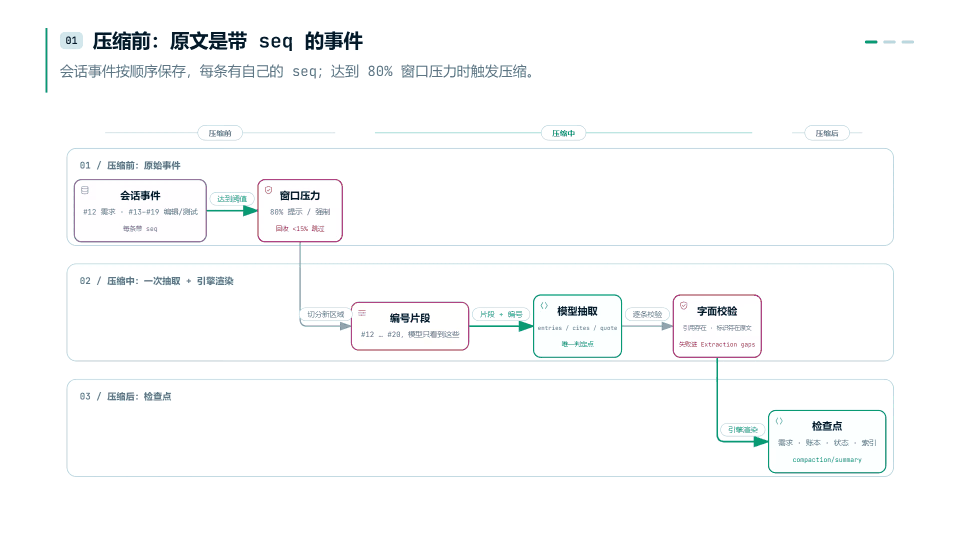

# dsh-wsc

## 介绍

WSC（Work State Compaction）的 DeepSeek Harness 压缩后端，包名 `@xeyo/dsh-wsc`。
它替换 dsh 原生的 `compaction-basic`：压力触发沿用 dsh 的窗口压力机制，压缩结果不再
是一段自由改写的摘要，而是由引擎按固定格式渲染、逐条可回查的检查点。

`mode: active` 时接替原生后端；`off` / `shadow` 只记录、不改写上下文。

## 机制：基于状态，解决什么问题

原生压缩让模型用一段自然语言概括历史，状态和过程混在一起：哪条约束是用户原话、
哪个值由哪次编辑确立、哪次测试覆盖了哪个文件，都无法核对。长会话里一旦摘要把
"改过了"和"验证过了"写成一句话，后面的模型就容易把旧版本当成当前状态。

WSC 把压缩拆成两件事：

- **模型只判断关系**：从新区域里提取事实、决定与修订，并给出引用消息的编号。
- **引擎负责状态**：用户需求（含约束）逐字保留并按出现顺序编号；账本按
  constraint > requirement > decision > verification > fact 排序；工作状态由编辑/
  测试回执推导；读、命令、编辑事件都带会话 seq 进入证据索引。

压缩后模型拿到的是"当前状态 + 出处"，而不是"对历史的复述"。

举例：第 12 轮用户说"把 TAX_RATE 改成 0.07，报表上限改成 500，别改 API 字段名"，
随后改 `src/tax.py`、改 `src/report.py`，第 17 轮测试失败、第 19 轮通过。到第 30 轮，
一段摘要可能只留下"税率和报表上限已修改，测试通过"；模型无法判断上限是不是还是 500、
API 字段名能不能动、`src/report.py` 的最后一次编辑有没有被测试覆盖。WSC 的检查点
（节选，实际格式见 `docs/checkpoint-format.md`）保留这些关系：

```
User requirements (verbatim, in order):
1. "把 TAX_RATE 改成 0.07，报表上限改成 500，别改 API 字段名"
Ledger (current):
- Constraint: 不改 API 字段名.
- Decision: 报表上限改成 500.
- Context: src/tax.py: TAX_RATE = 0.07.
Checks: src/report.py was edited at #18; the check at #19 (pytest) reported: 4 passed.
Evidence index (fetch by key): [E2] … (read_evidence #18); …
```

需求是原话，约束和决定在账本里各有出处，检查和索引都指向会话 seq；模型需要原文时
按序号取回，而不是重新猜。

## 压缩前原文 → 压缩中如何进行 → 压缩后什么样



### 压缩前

原文以事件保存在会话里，每条事件有自己的 seq。是否压缩由窗口压力决定：
`effectiveWindowTokens: 256000` 把容量限制为模型可用窗口与 256k 的较小值
（`0` 表示不额外限制），`capacityPercent: 100` 取满这个容量；
`warnRatio: 0.8` 在用到容量 80% 时提示，`forceRatio: 0.8` 在同一位置强制。
提示触发的压缩如果可回收量低于预算的 `minReclaimRatio`（默认 15%），会被跳过；
强制触发不跳过。

### 压缩中

一次模型调用（`strategy: nosig`）：

1. 新区域按消息切成带编号的片段，模型只看到这些片段。
2. 模型返回 `entries` / `revise` 的 JSON，每条带 `kind`、`text`、`cites`
   （片段里的消息编号）和 `quote`。
3. 引擎逐条做字面校验：引用必须存在，`text` 里的标识符、路径、数值必须出现在被引用
   的消息里；校验失败的条目不进入账本，原因计入检查点末尾的 `## Extraction gaps`。

这是压缩里唯一的模型判定点。需求原文、排序、去噪、工作状态、检查行、证据索引都由
引擎计算，不经过第二次模型改写。

### 压缩后

检查点写入会话事件 `compaction/summary`，由 `lib/passage.js` 按固定顺序渲染：

- `Latest request`：长会话时置顶最新请求，避免被历史淹没。
- `User requirements (verbatim, in order)`：逐字用户需求，按出现顺序编号。
- `Ledger (current)`：抽取出的关系，按优先级排序；渲染期把同一 subject 的旧版本
  折叠成当前版本（`ledgerDenoise`），journal 中的原始记录不删除。
- `## Current state (model account; unverified)`：done / next / open / unknown。
  这些行由编辑回执、测试回执与需求词推导后写入；标题表示它们仍不是验证结论。
- `## Recent changes` 与 `Checks`：哪个文件在哪个 seq 被改、随后哪次检查覆盖了它。
- `Observed values`：工具结果里的常量行，可按 key 取回。
- `Evidence index`：区域内的读、命令、编辑事件，可按 `read_evidence #seq` /
  `read_history #seq` 取回原始事件。

超出字节预算时，让位顺序是 证据索引 → 观测值 → 账本；用户需求原文不裁剪。
被裁掉的条目会写明数量并保留 seq。压缩发生时 read-dedupe 状态被重置，压缩后的
第一次重读返回真实字节。

## 如何安装使用

要求：dsh 已安装；WSC 以插件包的形式接入 profile。

1. 把本包链接到 profile 的 `node_modules/@xeyo/dsh-wsc`（Windows 可用 junction）。
2. 在 profile 的 `cordis` preset 中启用 WSC、停用原生后端：

```yaml
- id: wsc-config
  name: "@xeyo/dsh-wsc"
  config:
    mode: active

- id: compaction-basic
  disabled: true

- insert:
    - id: wsc-engine
      name: "@xeyo/dsh-wsc/engine"
```

只写 `mode: active` 时使用 `index.js` 中的默认值：`effectiveWindowTokens: 256000`、
`capacityPercent: 100`、
`warnRatio/forceRatio: 0.8`、`retainRatio: 0`、`minReclaimRatio: 0.15`、
`ledgerCapBytes: 8000`、`ledgerDenoise/denoise/receiptSeq: true`、
`evidenceIndexRows: 20`；`requirementBoard` 默认关闭。完整 profile 示例见
`profiles/desktop.cordis.patch.yml`。

运行时产物：抽取用量与 journal 在 `$DSH_HOME/wsc/nosig/<session>.jsonl`，检查点在
会话事件 `compaction/summary` 里。不需要密钥，不访问外部服务。

自检：

```bash
npm test
```

## 目录

```
index.js  engine.js  client.js    配置解析、压缩后端、设置页
lib/                              检查点渲染、nosig 抽取、证据索引、状态投影、
                                  ledger 去噪、receipt 等实现
docs/checkpoint-format.md         检查点的区块顺序、来源与 seq 约定
docs/design-notes.md              设计取舍与未采用的方案
docs/assets/compaction-flow.gif   压缩流程图
profiles/                         最小接线示例与完整 desktop profile
tests/                            单元与离线契约测试
experiments/                      prod-matrix harness、场景与过往实验记录
```
