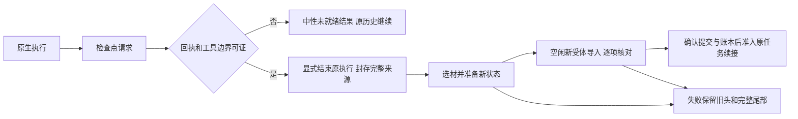

# 受控检查点 v0.2：显式交接替代活动回合原地压缩（设计，未实施）

来源：校准后C/S3输入增长与native-boundary-capability-v3。保留上一版阶段内投影提案；本版修正“能追加/能compact即能安全原地发布”的假设。长期目标仍是可承受成本的正确长期工作，不以控制接口演示替代任务收益。

## 两个不同层级

普通原生turn终止，不等于研究中的任务阶段完成。一个S3可以包含受控交接，但必须最终有正常交付与独立验收；旧C限额中断不追认成功。

提供方响应已有用量回执，也不等于工具与副作用全空闲。动态检查点回调可以被functions.exec包装或与其他工具并行；不能因一个回调出现就中断其他写入。新受体API接受，也不等于实际模型请求已获得完整交接。

## 受控交接状态

这个状态机尚未实现或验收。不能把图里的箭头当作已存在能力。

## 核心契约

1. **请求与提供方回执。** 以thread/turn/call/response身份关联记录，持有回调时验证对应响应已完成结算。并行或缺失回执均不得猜作零；默认普通turn账本不放宽。新受控操作将来需要独立种类及证据，原被截断实验保持旧分类。
2. **工具与后台工作。** 使用生命周期事件、响应内工具调用和进程/任务归属核对，而非仅thread/read。多工具批次、未知类型、仍运行写入或无法证明排空时，返回中性未就绪；不靠说教提示或静默杀任务制造边界。如何完整证明排空仍是实现前的首要问题。
3. **显式原执行结束。** 不在等待工具时调用原生compact来假装原地更新。若原执行必须受控结束，保存原生中断事实和任务未完成状态；从取消到来源封存的全过程必须可核对。工具transport aborted与实际检查点是否提交要区分，不能伪造工具成功。
4. **完整来源与失败保留。** 等原执行状态明确后封存源码/公开事件/调用结果及不可见或截断范围。原WSC头与未覆盖尾部保留；生成失败不能删尾部。恢复原完整历史若超容量则明确停止，不退到缺材料状态。旧头可用不代表随时可无条件恢复原生actor。
5. **复用已有发布契约。** 利用现有前缀/祖先验证与WSC stage/install/confirm/reconcile，添加真实宿主确认，不能绕过成导出后直接宣布提交。受体空闲时逐项核对安装源与实际日志/冷访问，再完成提交；持久化不明时走unknown/reconcile，禁止新推理抢跑。现有PendingHostCheckpoint的receipt=None必须保持未证明含义。
6. **任务和账本连续。** 所有旧actor响应、生成、查询、导入、失败及新actor响应共享同一臂预算。更换thread不新开额度。晚到回执、在途执行或提交不明都阻止继续收费任务；整个S3仅在真正交付后才算阶段成功。
7. **触发策略仍待决定。** 协作检查点不保证模型会在适当时间选择它；自动hook是否可用也未确认。不能靠导演提示逼模型少查少测，也不能宣称新工具会自动控制context增长。先核对接口、排空与预算信息可见性，再选明确可评估的策略。

## 验证与收益门槛

先用已有记录离线核对错误交接、并发工具、未结算响应、晚到回执、缺尾部、导入未提交和生成失败。若需要新小额真实协议验证，验证对象只能是与本次不同的受控结束/安装机制，不能复刻活动compact来补成功。

实现和小额能力证明都只能说明机制可运行；随后仍需原任务下正常C交付、全部质量要求和长期多轮验证。B原生压缩不改，相同宿主/任务/基线事实对称；如改变压缩时机，额外辨别时机收益与WSC选材收益，不能混称超越原生。记录缓存、重建、生成与恢复成本，不能只看输入变短。

本版没有修改默认runtime、没有新增业务开发或正式矩阵；原五任务各三轮、质量相近下总成本更优的目标不变。
